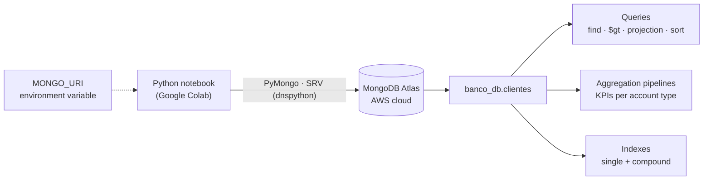

<div align="center">

# 🍃 NoSQL Financial Engine — MongoDB Atlas + PyMongo

**A banking customer store on MongoDB Atlas: CRUD, indexing, document modelling and multi-stage aggregation pipelines that compute financial KPIs, all driven from Python.**


</div>

---

## At a glance

| | |
|---|---|
| ☁️ **Database** | MongoDB Atlas cluster on AWS (`banco_db.clientes`) |
| 🧩 **Operations covered** | 33 notebook steps: CRUD, projection, sorting, counting, indexes, embedded documents, arrays |
| 📊 **Aggregation stages** | `$match` · `$group` · `$sort` · `$project` · `$count`, with `$sum`, `$avg`, `$min`, `$max`, `$multiply` |
| 🔐 **Credentials** | Connection string read from the `MONGO_URI` environment variable, never hard-coded |

## Why a document database for banking data

Customer records in a bank are not uniform: some customers have an address, some have several products, some carry a growing list of transactions. A document model handles that naturally:

- each customer is **one JSON document**, so reads need no joins;
- **embedded objects** (an address) and **arrays** (transactions) live inside the document they belong to;
- the **aggregation framework** computes KPIs server-side, close to the data.

## Architecture



## Data model

```json
{
  "_id": "ObjectId(...)",
  "nombre": "Elena Torres",
  "edad": 31,
  "tipo_cuenta": "ahorro",
  "saldo": 4200,
  "activo": true,
  "direccion": { "calle": "Gran Vía 12", "ciudad": "Madrid" },
  "transacciones": [100, -50, 200, 500]
}
```

## What it does

### 1. CRUD and querying

| Operation | PyMongo call | Business question |
|---|---|---|
| Create | `insert_one` | Onboard a new customer |
| Read | `find_one`, `find({"saldo": {"$gt": 3000}})` | Who holds more than €3,000? |
| Update one | `update_one(..., {"$set": {"activo": False}})` | Deactivate an account |
| Update many | `update_many(..., {"$inc": {"saldo": 200}})` | Credit a bonus to every current account |
| Delete | `delete_one` | Close a customer record |
| Shape results | projection, `sort(..., DESCENDING)`, `count_documents` | Ranking and counts for reports |

### 2. Aggregation pipelines (financial KPIs)

```python
pipeline = [
    {"$match": {"activo": True}},                                   # only active customers
    {"$group": {"_id": "$tipo_cuenta", "gran_total": {"$sum": "$saldo"}}},
    {"$sort":  {"gran_total": -1}},                                  # biggest segment first
]
```

KPIs computed this way:

- customers and **average balance per account type**;
- **total balance of active customers**, overall and by segment;
- age range of the customer base (`$min` / `$max`);
- average age of active vs. inactive customers;
- segments whose average balance exceeds a threshold (a `$match` **after** `$group`, the NoSQL equivalent of SQL `HAVING`);
- derived fields with `$project` + `$multiply` (currency conversion).

### 3. Performance and modelling

- **Single and compound indexes** (`tipo_cuenta` ascending + `saldo` descending) to support "filter by segment, sort by balance" queries, plus listing and dropping indexes.
- **Embedded documents** queried with dot notation (`"direccion.ciudad": "Madrid"`).
- **Arrays** updated atomically with `$push` and queried by element value (`{"transacciones": {"$gt": 300}}`).

## Run it yourself

```bash
pip install pymongo dnspython
export MONGO_URI="mongodb+srv://<user>:<password>@<cluster>.mongodb.net/"
jupyter notebook Conexion_con_MongoDB.ipynb   # or open it in Google Colab
```

A free MongoDB Atlas M0 cluster is enough. In Colab, store `MONGO_URI` in the Secrets panel.

## Tech stack

| Area | Tools |
|---|---|
| Database | MongoDB Atlas (AWS) |
| Driver | PyMongo, dnspython (SRV connection strings) |
| Environment | Google Colab / Jupyter |

## Next steps

- Seed the collection with a larger synthetic dataset and benchmark queries with and without indexes (`explain()`)
- Model transactions as sub-documents (amount, date, type) and aggregate them with `$unwind`
- Add schema validation with `$jsonSchema`

---

<div align="center">

Built by **Marcos** · [@mmartinezvaras](https://github.com/mmartinezvaras)

</div>
